# 🖨️ Expert System for Digital Printing Material Selection

A web-based expert system developed for **Fortune Digital Printing** to help customers and staff determine suitable digital printing materials using the **Rule-Based Forward Chaining Method**.

Beyond providing intelligent material recommendations, this application also serves as a **digital product catalog and promotional platform** to showcase printing products, highlight product information, and promote products offered by Fortune Digital Printing.

## 🔗 Live Demo & Repositories

🌐 **Live Application:** [Visit Website](https://front-end-es-opal.vercel.app/)

💻 **Frontend Repository:** [View Frontend Source Code](https://github.com/Yudhadp13/front-end-es)

⚙️ **Backend API Repository:** [View Backend Source Code](https://github.com/Yudhadp13/back-end-es)

Explore the live application and source code to learn more about the implementation, architecture, and features of this project.

---

## 📌 Project Overview

Choosing the right printing material can be challenging due to the variety of available materials and their different characteristics, specifications, and applications.

This project aims to simplify the material selection process through a web-based expert system that provides recommendations based on user requirements and predefined knowledge-base rules.

The application also supports product promotion by presenting a catalog of printing materials and promotional banners, helping customers discover available products before making purchasing decisions.

### 🎯 Project Objectives

- **Intelligent Recommendations:** Help customers select suitable printing materials based on their specific needs.
- **Product Promotion:** Showcase printing products, specifications, and promotional content through a digital platform.
- **Decision Support:** Assist staff in providing more consistent and systematic material recommendations.
- **Information Accessibility:** Make printing material information easier to access and understand.
- **Operational Efficiency:** Reduce reliance on manual consultations and individual staff experience.

---

## ✨ Key Features

The application provides two main access levels: **User** and **Administrator**.

### 👤 User Features

#### 1. Secure Authentication
- User registration and login.
- Account activation.
- Profile and account management.

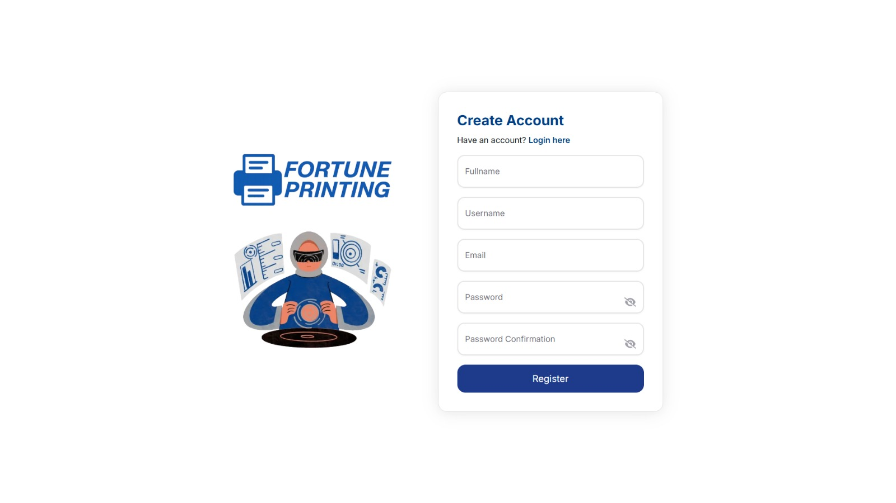
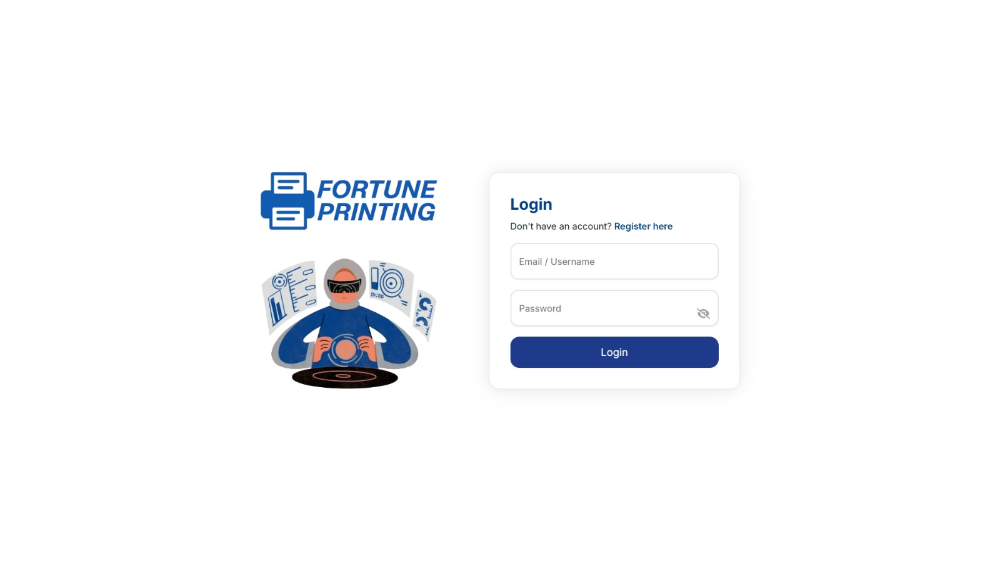

#### 2. Homepage & Product Catalog
- Browse available digital printing materials.
- View product categories and material specifications.
- Explore promotional banners and featured products.
- Discover products offered by Fortune Digital Printing.

This feature serves both as an information center and a promotional medium to introduce products to potential customers.

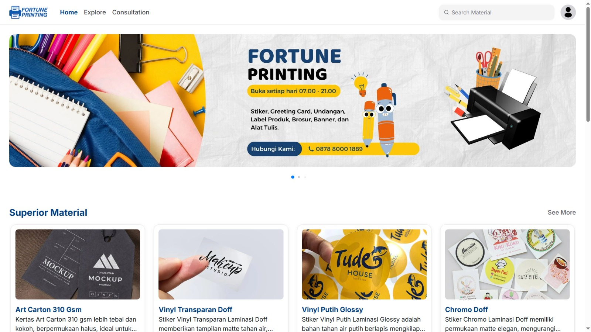
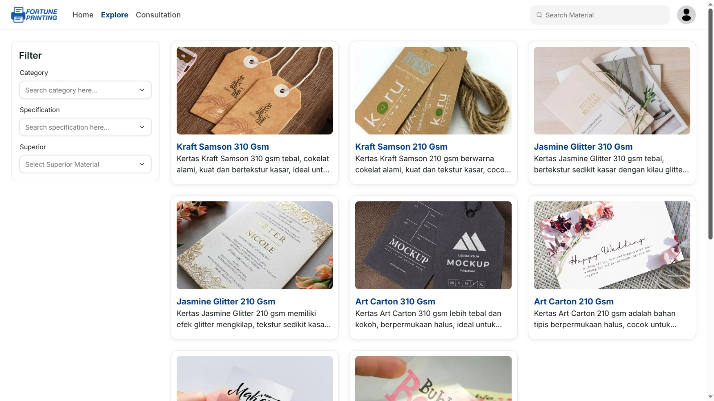

#### 3. Interactive Expert System Consultation
- Answer a series of questions based on printing requirements.
- Process user responses through the Forward Chaining inference method.
- Receive material recommendations based on predefined rules.
- View recommendation results relevant to the selected requirements.

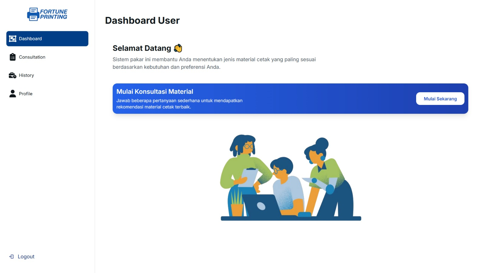
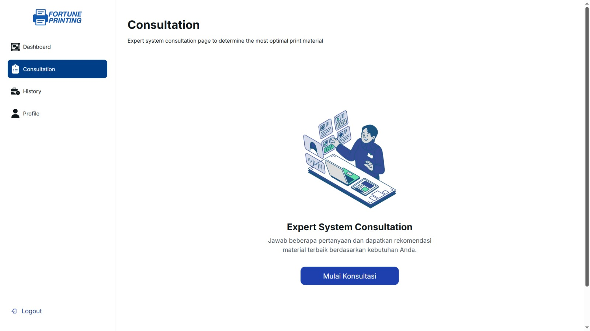
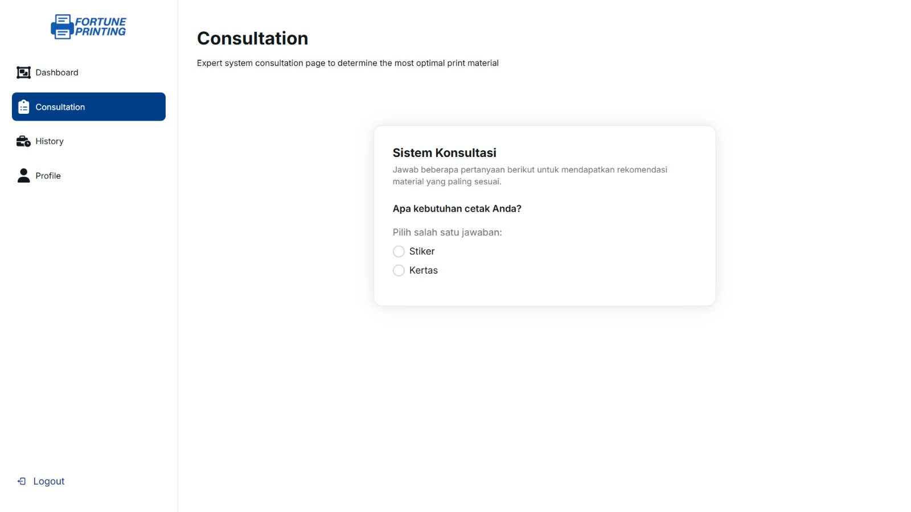
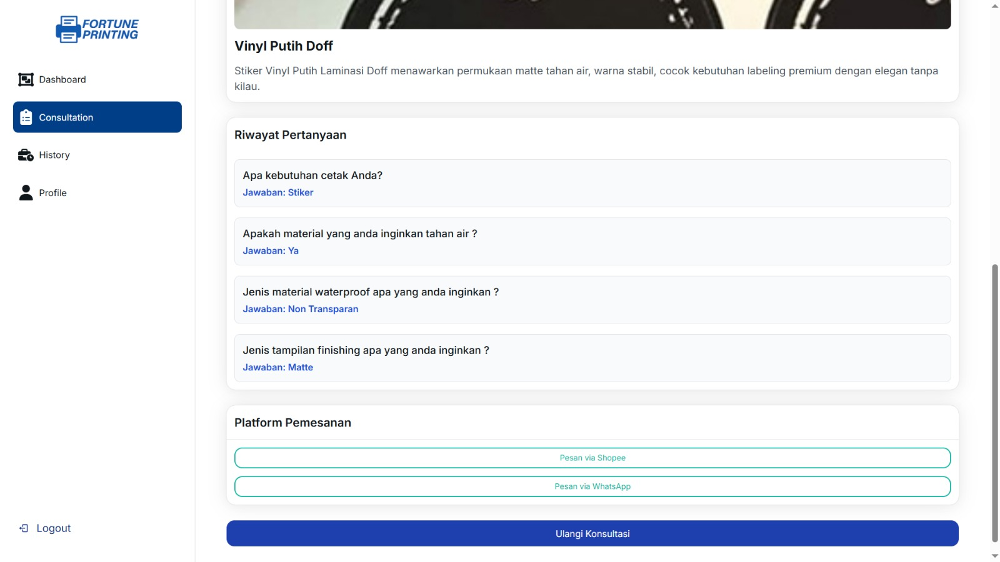

#### 4. Consultation History
- View previous consultation sessions.
- Review recommendation results.
- Access previously recorded consultation information.

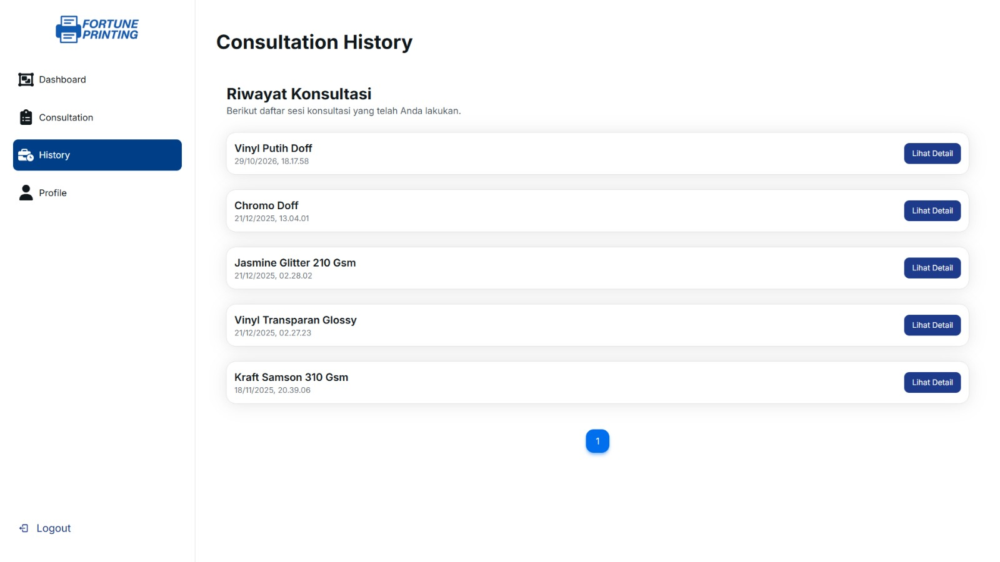

#### 5. Profile Management
- Update personal information.
- Manage profile details.
- Change account passwords.

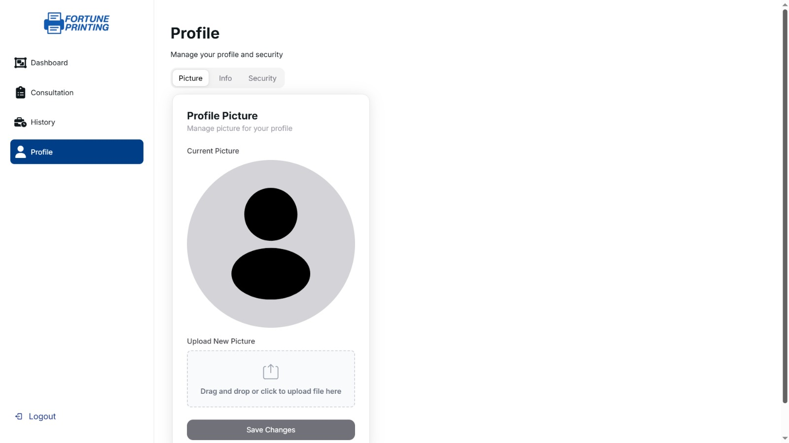

---

### 🛡️ Administrator Features

#### 1. Admin Dashboard
Provides an overview of the application's data and activities, including materials, categories, rules, and user consultations.

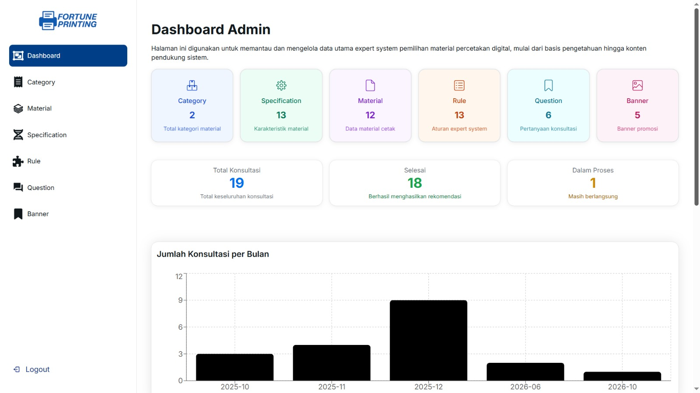
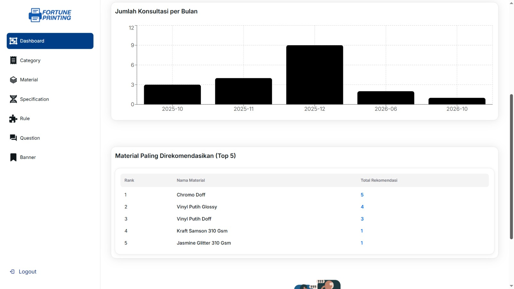

#### 2. Knowledge Base Management
- Create, edit, and delete consultation questions.
- Configure answer options and their associated specifications.
- Create and maintain IF–THEN rules.
- Manage the knowledge base used by the inference engine.

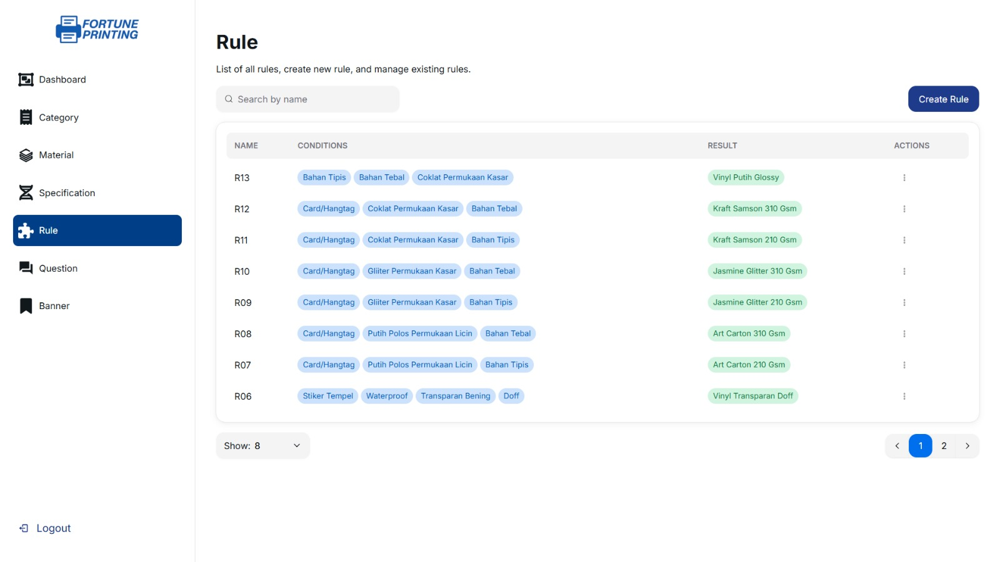
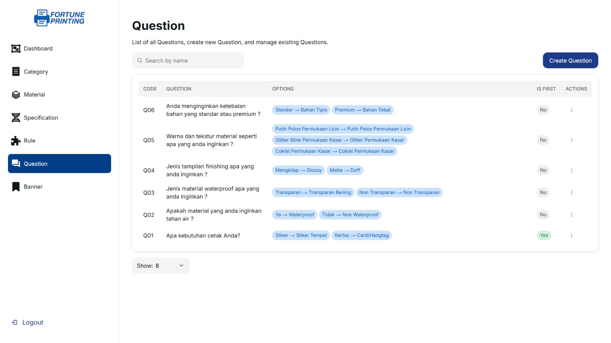

#### 3. Master Data Management
Manage the core data used throughout the application:

- **Categories:** Organize printing materials into categories.
- **Materials:** Maintain the catalog of available printing materials.
- **Specifications:** Store the characteristics and technical specifications used in the recommendation process.

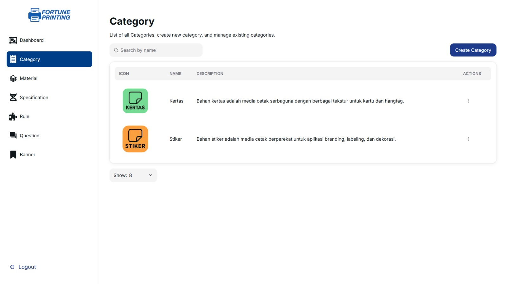
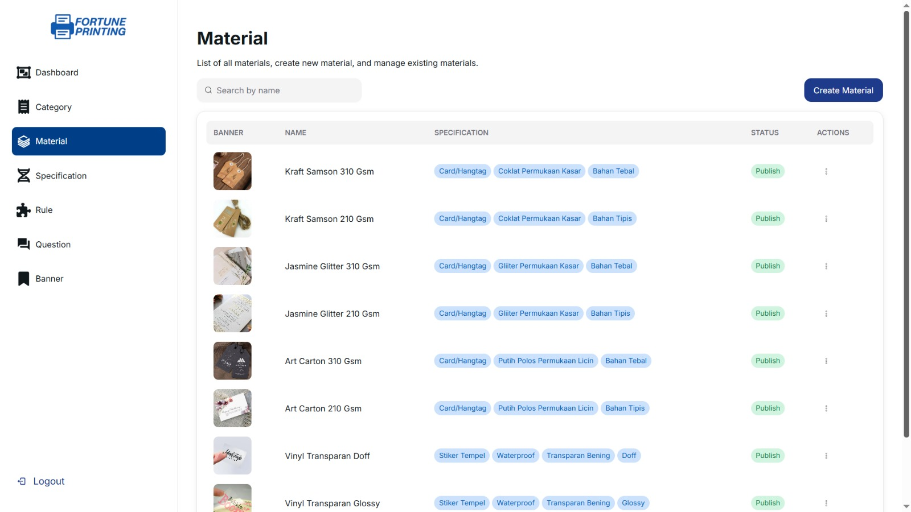
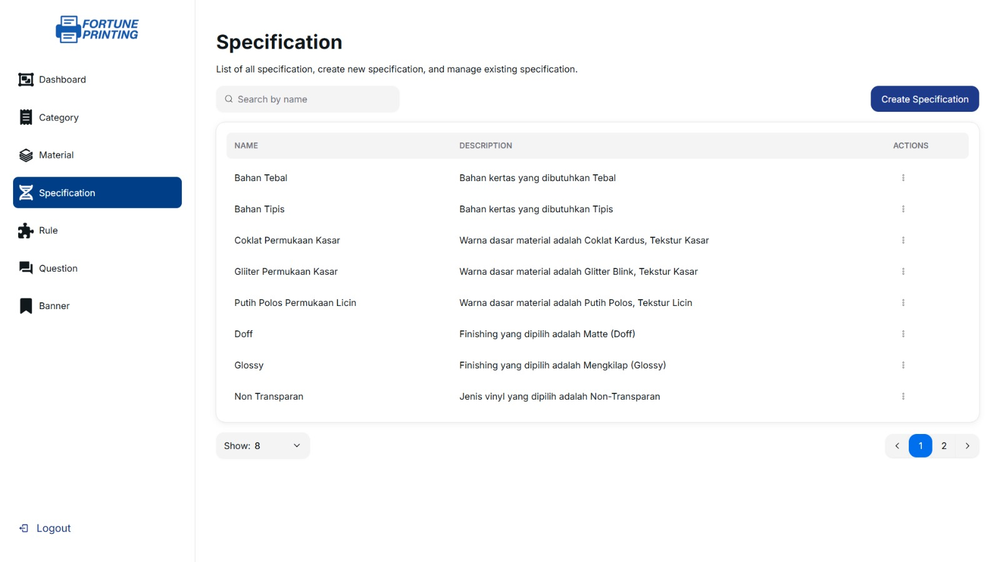

#### 4. Promotional Banner Management
- Upload promotional banner images.
- Update existing banners.
- Manage promotional content displayed on the homepage.

This feature enables administrators to promote selected products and communicate relevant product information through the website.

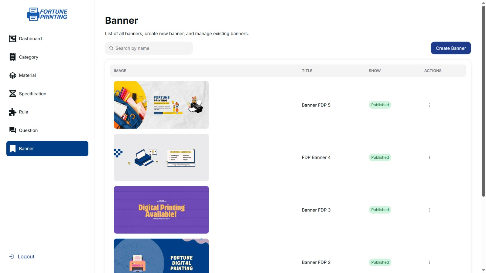

---

## 🧠 Core Engine: Forward Chaining

The expert system uses the **Forward Chaining inference method**, a data-driven reasoning approach that starts with known facts and applies predefined rules to derive a conclusion.

### How It Works

1. **User Input:** The user answers questions about their printing requirements.
2. **Fact Collection:** The system collects the specifications associated with the selected answers.
3. **Rule Evaluation:** The inference engine checks the collected facts against predefined IF–THEN rules in the knowledge base.
4. **Inference Process:** Rules whose conditions are satisfied are evaluated to determine the resulting material.
5. **Recommendation Result:** The system displays the material recommendation derived from the applicable rules.

### Example of a Rule

```text
IF
  The required material has specification A
  AND the required material has specification B

THEN
  Recommend Material X
```

The actual recommendations depend on the questions, specifications, and rules configured in the application's knowledge base.

---

## 🛠️ Tech Stack

This project was developed using a modern web development stack.

| Technology | Purpose |
|---|---|
| [Next.js](https://nextjs.org/) | React-based web framework |
| [React](https://react.dev/) | Building interactive user interfaces |
| [TypeScript](https://www.typescriptlang.org/) | Static typing and maintainable code |
| [Tailwind CSS](https://tailwindcss.com/) | Responsive UI styling |
| [PostCSS](https://postcss.org/) | CSS processing |
| [ESLint](https://eslint.org/) | Code quality and linting |
| [Prettier](https://prettier.io/) | Consistent code formatting |

**Development Tools:** Node.js and npm.

*Note: The technology list reflects the frontend stack described for this project. Add backend, database, or other technologies here if they are part of this repository's implementation.*

---

## 📂 Project Structure

The frontend follows a Next.js-based project structure. The directory layout below is illustrative and should be adjusted to match the actual repository.

```text
front-end-es/
├── public/
│   ├── images/
│   └── icons/
├── src/
│   ├── app/ or pages/
│   ├── components/
│   ├── styles/
│   ├── lib/
│   ├── hooks/
│   └── utils/
├── package.json
├── tsconfig.json
├── tailwind.config.ts
├── postcss.config.mjs
├── eslint.config.mjs
└── README.md
```

- **public/** — Static assets such as images, icons, and other public files.
- **src/app/** or **src/pages/** — Application routes and page-level components, depending on the routing system used.
- **src/components/** — Reusable UI components.
- **src/styles/** — Global styles and styling resources.
- **src/lib/** — Shared libraries and API-related utilities.
- **src/hooks/** — Custom React hooks.
- **src/utils/** — Helper functions and reusable utilities.

---

## 🚀 Getting Started

Follow these steps to run the frontend application locally.

### Prerequisites

Make sure the following tools are installed:

- Node.js
- npm
- Git

### 1. Clone the Repository

```bash
git clone <YOUR_REPOSITORY_URL>
cd front-end-es
```

Replace `<YOUR_REPOSITORY_URL>` with the actual URL of this GitHub repository.

### 2. Install Dependencies

```bash
npm install
```

### 3. Configure Environment Variables

If the application requires environment variables, create a `.env.local` file in the project root and configure the required values.

Example:

```env
NEXT_PUBLIC_API_URL=<YOUR_BACKEND_API_URL>
```

Use the variable names expected by the actual source code. Do not commit secret keys or credentials to the repository.

### 4. Run the Development Server

```bash
npm run dev
```

### 5. Open the Application

Navigate to:

```text
http://localhost:3000
```

---

## 🎓 Project Context

This project was developed as part of an academic project focused on applying expert system concepts to digital printing material selection.

The application combines a rule-based recommendation system with product catalog and promotional features to support customer decision-making and improve access to printing material information.

**Industry:** Digital Printing  
**Application Type:** Web-Based Expert System  
**Inference Method:** Forward Chaining  
**Target Users:** Customers and administrators of Fortune Digital Printing

---

## 👨‍💻 Developer

Developed as a web-based information system project with a focus on software development, decision-support systems, and digital business solutions.

**GitHub:** [Yudhadp13](https://github.com/Yudhadp13)

